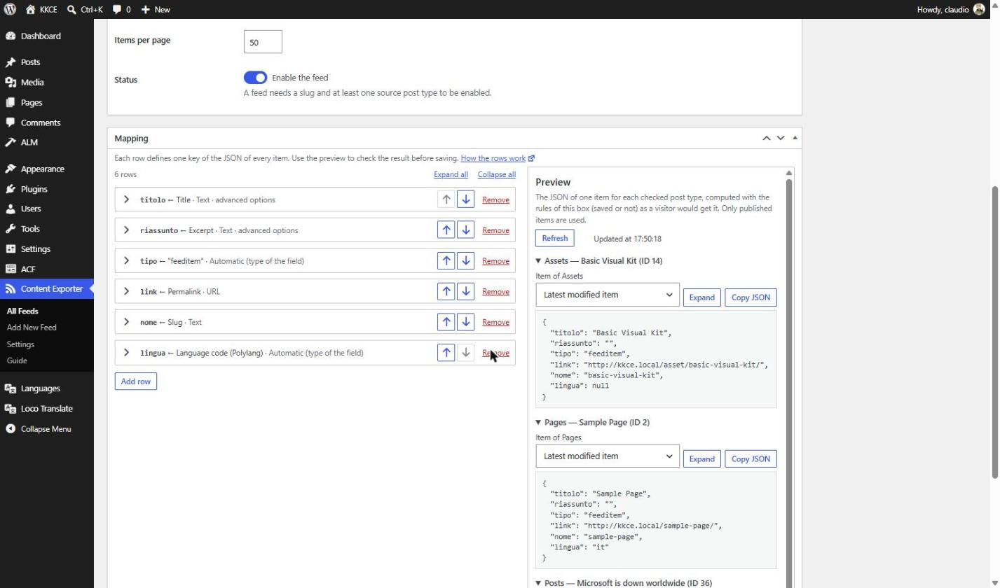
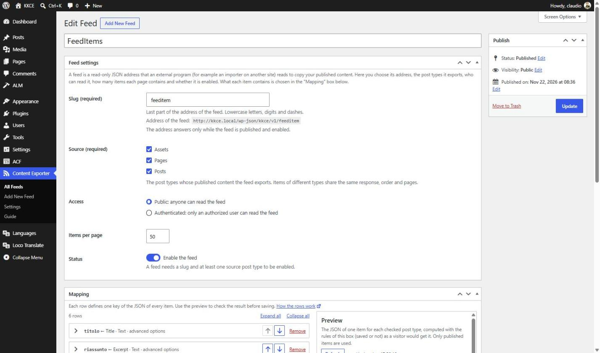
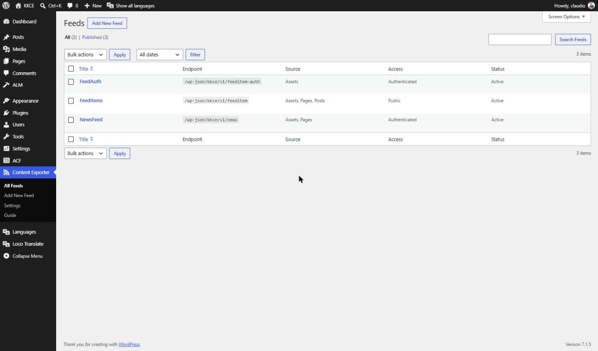
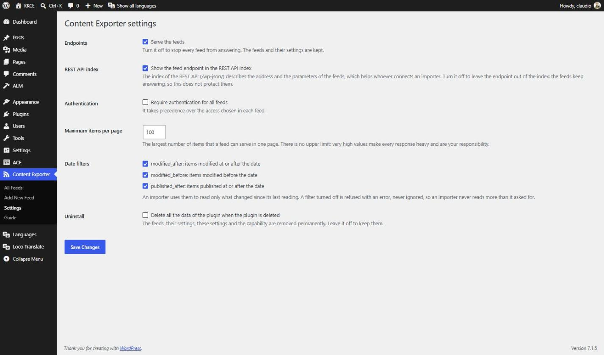
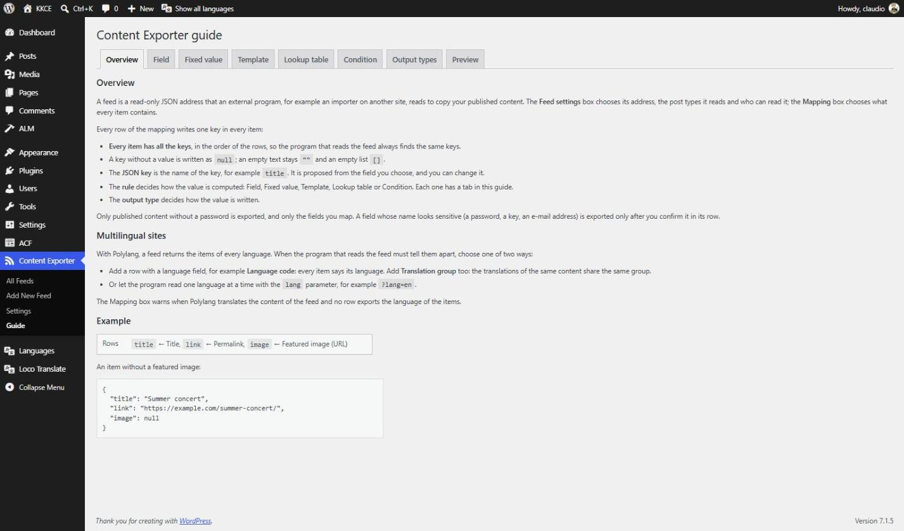
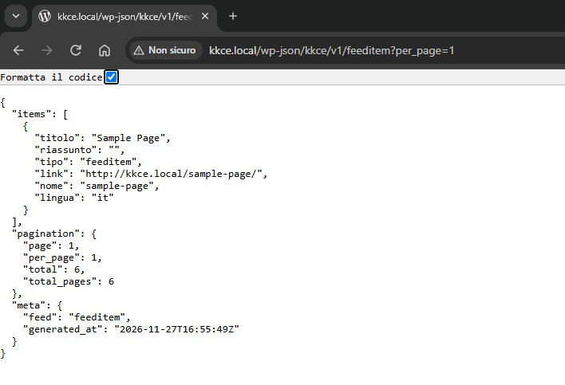

# KK Content Exporter

[](https://github.com/ilclaudio/kk-content-exporter/actions/workflows/ci.yml)
[](LICENSE)
[](https://phpstan.org/)
[](https://github.com/ilclaudio/kk-content-exporter/tags)

KK Content Exporter makes published WordPress content available as read-only JSON feeds through a
REST API. Other websites, applications and systems can read these feeds or use them to import data.

Choose which content to include, which fields to expose and what to call them. Give different content
types a common structure so other systems can use them without knowing how they are organized inside
WordPress.

For installation and a first-feed walkthrough, see [`readme.txt`](readme.txt). The sections below cover
the plugin's operation, REST API and development workflow.

## Project status

Version 1.0.0 is being prepared for the WordPress.org Plugin Directory. It offers feed configuration, the
mapping editor with preview and save, WordPress core fields and selected post meta, public and authenticated
feeds with pagination and date filters, the URL of the featured image, the terms of the taxonomies and the
language (of the site, and of each item with Polylang). Version 1.1.0 plans meta dates, ACF and CMB2 fields,
duplication and export/import of feeds, and a lighter IDs-only mode of the endpoint.

## Requirements

- WordPress 6.4 or later, PHP 8.3 or later.
- No runtime dependencies. Composer is used only for development tools and is never shipped.

## How it works

1. An administrator creates a feed and selects one or more public post types.
2. Mapping rows define each output key and its value: a source field, fixed value, template, lookup
   table or condition. Fields from different post types can supply the same output key.
3. The preview and the feed use the same mapping engine. It reads the selected sources, evaluates
   the rules and converts values to the chosen output types.
4. The feed endpoint returns published, non-password-protected items in a shared JSON structure.
   Only mapped fields are included; each mapped key is present, with `null` when no value is available.

For example, a site stores news and events with different fields. A feed can present both with the
same fields, such as title, description and link, so another system can read them in the same way.

Feeds are stored in the private `kkce_feed` post type, with configuration in post meta. The plugin
queries source content directly, so a source post type does not need `show_in_rest`. It leaves the
original content and its visibility unchanged, and does not replace WordPress's native REST API.
The receiving system handles reading or importing the data.

## Screenshots

The Mapping box: each row writes one JSON key, with a live preview of the items a reader will receive.



Feed settings: address, source content types, public or authenticated access, items per page and status.



The list of feeds with their address, source, access and status.



Global settings: serving the feeds, REST API index, authentication, page limit and date filters.



The built-in guide that explains every mapping rule with examples.



The JSON of a public feed, read with a plain GET request without authentication.



## Global settings

Administrators manage **Content Exporter > Settings** through the WordPress Settings API. The option
`kkce_settings` holds these values; `KKCE\Settings` defines their defaults and validation, and
`KKCE\Admin\Settings_Page` renders the controls. The user guide in [`readme.txt`](readme.txt) explains
each control and the diagnostic messages.

| Setting | Option key | Default | Effect |
|---|---|---|---|
| Endpoints | `enabled` | `true` | Registers the feed route when on; when off, requests return 404 and feed configuration is retained. |
| REST API index | `show_in_index` | `true` | Includes the feed route and parameter descriptions in REST discovery. Turning it off does not disable or protect feed URLs. |
| Authentication | `require_auth` | `false` | Overrides per-feed access and requires Application Password authentication for every feed. |
| Maximum items per page | `max_per_page` | `100` | Positive integer, with no fixed upper ceiling. Caps a feed's configured page size; an explicit `per_page` above it is rejected. |
| Date filters | `filter_modified_after`, `filter_modified_before`, `filter_published_after` | `true` | Each one allows its date parameter; a request with a parameter turned off is rejected with HTTP 400, never ignored. |
| Uninstall | `remove_data` | `false` | On plugin deletion, removes feeds, configuration and the export capability from roles and users. Source content is retained; deactivation does not perform cleanup. |

Diagnostics check for blocked anonymous REST access, unavailable Application Passwords and enabled
feeds with confirmed sensitive sources. They report warnings without changing settings or making
external requests. Feed-based diagnostics inspect at most 100 feeds; they are not a complete audit
of every feed on a large site.

## Using the REST API

The complete guide for the developers of a program that reads the feeds (response, pages, access, date
filters, removed items, languages, errors) is [`docs/reading-a-feed.md`](docs/reading-a-feed.md).

Each feed has its own endpoint: `GET /wp-json/kkce/v1/<feed-slug>`. It must be published and enabled
before it can be read. Requests have no body; use the exact feed URL shown in the editor.

A missing, unpublished or disabled feed, or one without mapping rows, answers HTTP 404
(`kkce_feed_not_found`); the editor and the list of the feeds mark an enabled feed that is not
published. Invalid parameters answer HTTP 400 (`rest_invalid_param`) with an explanation.

### Public feeds

For a public feed with the slug `news` on an example site:

```sh
curl 'https://example.com/wp-json/kkce/v1/news?page=1&per_page=2'
```

### Response format and pagination

A feed mapped to `title` and `url` might return:

```json
{
  "items": [
    { "title": "Site news", "url": "https://example.com/site-news/" },
    { "title": "Community event", "url": "https://example.com/community-event/" }
  ],
  "pagination": { "page": 1, "per_page": 2, "total": 2, "total_pages": 1 },
  "meta": { "feed": "news", "generated_at": "2026-11-20T12:00:00Z" }
}
```

`items` contains the mapped data, `pagination` describes the result pages, and `meta` identifies the
feed. Its `generated_at` value is the UTC timestamp when the response was generated.

Use `page` to read successive pages; `per_page` cannot exceed the maximum in the plugin settings.
Items are ordered by modified date in UTC, then ID, both ascending. A page after the last one returns
an empty `items` list with the real totals.

### Date filters

`modified_after`, `modified_before` (modified date) and `published_after` (publication date) select
items by date, for example to read only what changed since the previous reading:

```sh
curl 'https://example.com/wp-json/kkce/v1/news?modified_after=2026-11-01T10:00:00Z'
```

Dates are ISO 8601 with a time zone (`Z` or an offset such as `+01:00`), with years from 1000 to 9999;
fractions of a second are ignored. The interval is half-open: `after` includes the date, `before`
excludes it. A date without a time zone, an empty interval or a filter turned off in the settings
answers HTTP 400. Changes made by code only to meta, terms or the featured image do not change the
modified date, so an importer should also read the whole feed from time to time.

### Multilingual sites (Polylang)

Without `lang` a feed returns the items of every language. Map the language fields (for example
**Language code** and **Translation group**) so that each item says its language and which items are
translations of the same content. To read one language only, add `lang` with a Polylang language code:

```sh
curl 'https://example.com/wp-json/kkce/v1/news?lang=en'
```

Items of post types that Polylang does not translate are always included. `lang` combines with pages
and date filters; an unknown language, or `lang` on a site without Polylang, answers HTTP 400. WPML is
not supported.

### Authenticated feeds

For an authenticated feed, use HTTPS and a WordPress Application Password belonging to a user with
the `kkce_read_export` capability. Administrators receive that capability on plugin activation.
For example, with a user named `export-reader`:

```sh
curl --user export-reader 'https://example.com/wp-json/kkce/v1/news'
```

When curl prompts for a password, enter the Application Password, not the user's normal login
password. A browser login alone does not authorize an authenticated feed.

A protected feed responds with HTTP 401 when authentication is required. The plugin adds
`WWW-Authenticate: Basic realm="KK Content Exporter"` to its own endpoint's 401 responses when
WordPress Application Passwords are available, including authentication failures on public feeds and
anonymous admin requests. A valid Application Password without the export capability receives HTTP 403.
Native WordPress and other plugins' REST responses are left unchanged.

## Development setup

Tools needed on the development machine: PHP 8.3+ and Composer for the static checks and the unit
tests; in addition, for the integration and end-to-end tests in Docker, Node 24 and Docker Desktop.

```sh
composer install                 # PHP tools: PHPCS, PHPStan, PHPUnit, Brain Monkey, WP-CLI i18n
composer run hooks:install       # Git hooks: secret scan, lint, PHPCS, PHPStan, unit tests
npm ci                           # test tools: wp-env, Playwright, axe-core
npx playwright install chromium  # browser of the end-to-end tests (once per machine)
```

## Code layout

| Path | Purpose |
|---|---|
| `kk-content-exporter.php`, `includes/class-plugin.php` | Bootstrap, autoloading setup and hook registration |
| `includes/admin/` | Feed list, editor and settings screens |
| `includes/sources/` | Catalog of selectable fields and providers that read their values |
| `includes/output/` | Mapping validation, rule evaluation, value conversion and response structure |
| `includes/rest/` | Feed endpoints, access decisions and editor catalog/preview routes |
| `assets/` | Admin JavaScript and CSS, with no build step |
| `tests/` | Unit, WordPress integration and browser tests |
| `bin/` | Development and release scripts, excluded from the plugin package |

Pure mapping and validation logic is separated from WordPress hooks, queries and REST handling.

## Checks and tests

```sh
composer run check             # lint + PHPCS + PHPStan + unit tests: the fast gate before every commit
composer run test:integration  # integration tests in Docker
composer run test:e2e          # end-to-end tests in Chromium
```

CI validates Composer files and GitHub Actions workflows, runs the checks and integration suites,
builds the release ZIP, and audits dependencies (npm HIGH and CRITICAL findings block CI).
It runs on pushes and pull requests to `main`/`dev` and can be started manually; E2E has its own manual
workflow. Dependabot proposes monthly tool updates to `dev`, with up to three PRs per ecosystem.
Manual workflow controls and scheduled dependency updates require their configuration on the default branch.

The three test levels, every command and when to run it: [`tests/README.md`](tests/README.md).
Manual checks of the feed endpoint on a development site, in Insomnia or with
`node tests/routes/run-routes.mjs`: [`tests/routes/README.md`](tests/routes/README.md).

Docker environments use separate configurations: `.wp-env.inttest.json` creates
`wp-env-kk-content-exporter-inttest-<hash>` for integration tests (port 8891), and
`.wp-env.e2etest.json` creates `wp-env-kk-content-exporter-e2etest-<hash>` for end-to-end tests (port 8890).
Use the Composer commands to select the right environment; direct wp-env commands require `--config`.
The integration environment also downloads Polylang from WordPress.org, a fixed version, for the tests
in `tests/integration/polylang/`; the plugin itself never requires it.

## Release

`composer run build:zip` builds `build/kk-content-exporter-<version>.zip` from a clean working tree;
the files left out of the package are listed in [`.distignore`](.distignore). Run
[Plugin Check](https://wordpress.org/plugins/plugin-check/) on the built package, not on the working
folder.

## Contributing, security and license

- [`CONTRIBUTING.md`](CONTRIBUTING.md): rules for contributions.
- [`SECURITY.md`](SECURITY.md): how to report a vulnerability.
- [`CHANGELOG.md`](CHANGELOG.md): changes per version.
- License: GPL-3.0-or-later, see [`LICENSE`](LICENSE).
